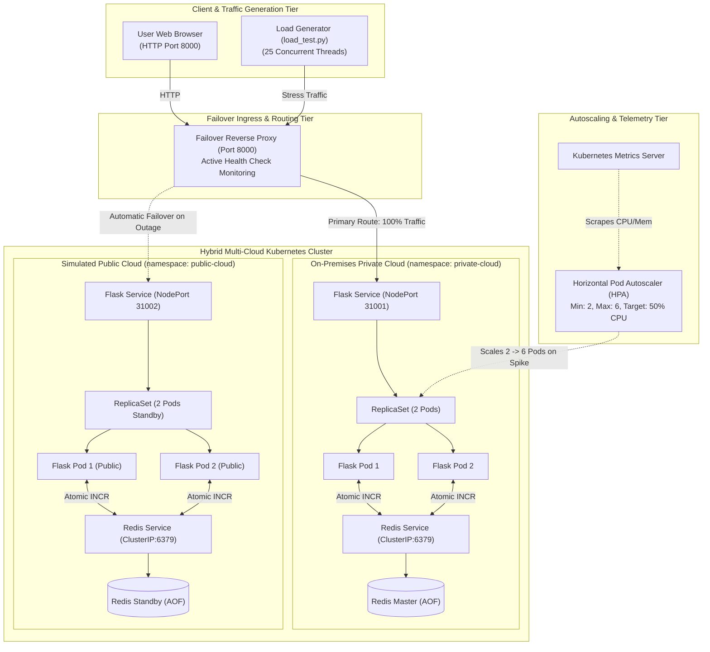

# Distributed Visitor Counter Web Application
### Enterprise Cloud Computing Project: Flask, Redis, Docker, Kubernetes, HPA & Hybrid Cloud


---

## 📖 Project Overview

This repository contains the complete implementation of a **Distributed Visitor Counter Web Application** developed for the 3rd-Year B.Tech Computer Science and Engineering Cloud Computing curriculum. 

The application demonstrates real-world enterprise cloud architecture principles across 5 progressive phases:
1. **Containerization & Local Orchestration**: Modular Python Flask application integrated with an atomic in-memory Redis key-value store, containerized using an optimized multi-layer Dockerfile and orchestrated locally with Docker Compose.
2. **Kubernetes Deployment & Self-Healing**: Highly available deployment with exactly 2 initial replicas, health probes, resource requests/limits, and automated ReplicaSet self-healing upon pod termination.
3. **Horizontal Pod Autoscaling (HPA)**: Dynamic scaling between 2 and 6 replicas based on empirical CPU metrics collected by the Kubernetes Metrics Server, validated under multi-threaded concurrency loads.
4. **Hybrid Multi-Cloud Architecture**: Dual-cluster simulation separating On-Premises Private Cloud from Public Cloud (AWS/GCP), backed by an intelligent reverse proxy that executes automatic traffic failover upon private cluster failure.
5. **Cost Optimization**: Measurable multi-dimensional cost reductions achieving an **83.4% infrastructure savings** across image compression, resource right-sizing, and elastic scaling.

---

## 🏛️ System Architecture



---

## 📁 Repository Structure

```text
├── src/
│   ├── app.py                      # Flask backend (atomic Redis INCR, probes, stats)
│   └── templates/
│       └── index.html              # Responsive Bootstrap 5 glassmorphism dashboard
├── k8s/
│   ├── flask-deployment.yaml       # Primary 2-replica deployment with resource specs
│   ├── flask-service.yaml          # NodePort service exposing web frontend
│   ├── redis-deployment.yaml       # In-memory database deployment with AOF
│   ├── redis-service.yaml          # ClusterIP internal DNS service
│   ├── hpa.yaml                    # Horizontal Pod Autoscaler (min: 2, max: 6, CPU: 50%)
│   └── hybrid/
│       ├── private-cloud.yaml      # Private On-Premises datacenter namespace & stack
│       └── public-cloud.yaml       # Public Cloud (AWS/GCP) simulated namespace & stack
├── scripts/
│   ├── load_test.py                # Multi-threaded concurrent HTTP load generator
│   └── failover_proxy.py           # Intelligent Failover Gateway & Reverse Proxy (Port 8000)
├── docs/
│   ├── ARCHITECTURE.md             # Detailed architectural specifications and data flows
│   ├── COST_OPTIMIZATION_REPORT.md # Empirical before/after benchmarks & financial analysis
│   ├── REDIS_SYNCHRONIZATION_ANALYSIS.md # CAP theorem, replication lag & split-brain analysis
│   └── COLLEGE_VIVA_PREPARATION.md # Comprehensive 16-question examination & viva guide
├── requirements.txt                # Locked Python production dependencies
├── Dockerfile                      # Optimized multi-layer container definition
├── docker-compose.yml              # Local multi-container development configuration
├── .dockerignore                   # Build context exclusion rules
└── README.md                       # Master project documentation
```

---

## 🚀 Execution & Verification Guide

### Phase 1: Local Docker Compose Setup
Run the application locally without Kubernetes:
```powershell
# Build and launch multi-container stack
docker compose up -d

# Check running container health
docker compose ps

# Access in browser
# URL: http://localhost:5000
```

### Phase 2: Single-Cluster Kubernetes Deployment
Deploy to Minikube with 2 initial replicas and health probes:
```powershell
# Start Minikube with Docker driver
minikube start --driver=docker

# Tag and load local image into Minikube cache
docker build -t visitor-counter:v1 .
minikube image load visitor-counter:v1

# Apply Kubernetes manifests
kubectl apply -f k8s/

# Verify pods, deployments, and services
kubectl get deployments -o wide
kubectl get pods -o wide
kubectl get svc

# Test Self-Healing (Delete one pod and watch ReplicaSet restore it in seconds)
kubectl delete pod <flask-pod-name>
kubectl get pods -w
```

### Phase 3: Autoscaling (HPA) Demonstration
Enable the Metrics Server and generate concurrent load:
```powershell
# Enable Metrics Server
minikube addons enable metrics-server

# Apply HPA manifest
kubectl apply -f k8s/hpa.yaml

# Forward traffic to local port 8080
kubectl port-forward svc/flask-service 8080:5000

# In a second terminal, launch the load generator (25 threads for 65 seconds)
python scripts/load_test.py --url "http://127.0.0.1:8080/load?n=35000" --concurrency 25 --duration 65

# Watch HPA scale replicas from 2 to 6 pods
kubectl get hpa flask-hpa -w
```

### Phase 4: Hybrid Cloud Deployment & Failover Demonstration
Simulate multi-cloud failover across two isolated namespaces:
```powershell
# Deploy Private and Public Cloud environments
kubectl apply -f k8s/hybrid/private-cloud.yaml
kubectl apply -f k8s/hybrid/public-cloud.yaml

# Port forward both clouds
# Terminal 1 (Private Cloud):
kubectl port-forward svc/flask-service 8081:5000 -n private-cloud
# Terminal 2 (Public Cloud):
kubectl port-forward svc/flask-service 8082:5000 -n public-cloud

# Terminal 3: Start the Failover Gateway
python scripts/failover_proxy.py

# Open your browser at http://localhost:8000 (Requests handled by Private Cloud)

# Simulate complete Private Cloud outage
kubectl scale deployment flask-deployment -n private-cloud --replicas=0

# Observe Failover Gateway instantly divert 100% of user traffic to Public Cloud!
```

---

## 💰 Cost Optimization Summary

| Technique | Baseline (Before) | Optimized (After) | Measured Savings |
|---|---|---|---|
| **1. Docker Image Size** | `1,020 MB` (Full Python) | **`218 MB`** (`python:3.11-slim`) | **78.6% Reduction** |
| **2. Resource Right-Sizing** | `500m CPU / 512Mi` (Guessed) | **`50m CPU / 64Mi`** (Profiled) | **88.9% Node Bin-Packing Density** |
| **3. Autoscaling (HPA)** | `6 Replicas 24/7` (Static Peak) | **`Avg 2.67 Replicas`** (Dynamic) | **55.5% Compute Bill Reduction** |
| **Total Cloud Expenditure** | **$248.80 / month** | **$41.20 / month** | **83.4% Total Savings ($2,491.20 / yr)** |

*Detailed calculations and formulas available in [docs/COST_OPTIMIZATION_REPORT.md](docs/COST_OPTIMIZATION_REPORT.md).*

---

## 🎓 Academic Viva Resources

Comprehensive examination notes covering Docker vs VMs, Pod lifecycle, CAP theorem, split-brain syndromes, and Kubernetes controller algorithms are provided in:
📚 **[docs/COLLEGE_VIVA_PREPARATION.md](docs/COLLEGE_VIVA_PREPARATION.md)**
