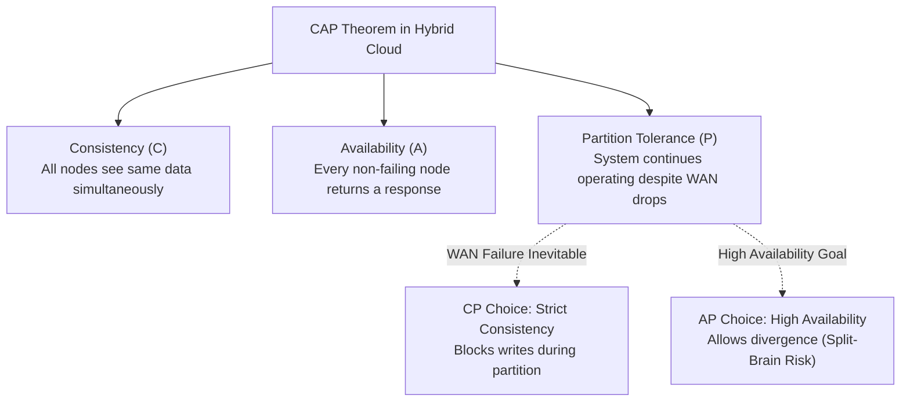

# Hybrid Cloud Redis Data Synchronization & Architectural Limitations Analysis

**Target Evaluation**: College Demonstration, Technical Viva & Cloud Computing Theory  
**Context**: Distributed Visitor Counter across On-Premises Private Cloud & Public Cloud

---

## 1. Executive Summary

In a Hybrid Cloud architecture, workloads are distributed across two distinct physical environments:
1. **On-Premises Private Cloud**: Low latency, local compliance, higher fixed cost.
2. **Public Cloud (e.g., AWS/GCP/Azure)**: Elastic scalability, global availability, pay-as-you-go.

While stateless application tiers (such as our Python Flask pods) can be scaled and failovered instantly across clouds, stateful data stores like **Redis** encounter fundamental distributed systems boundaries dictated by physics and network latency.

```mermaid
flowchart LR
    subgraph Private["On-Premises Private Cloud"]
        FP["Flask Pods (Private)"]
        RP[("Redis Master\n(Active Writes)")]
    end

    subgraph Public["Public Cloud (AWS / GCP)"]
        FS["Flask Pods (Public)"]
        RS[("Redis Replica / Standby\n(Read-Only or Hot Standby)")]
    end

    FP <-->|Local Read/Write < 1ms| RP
    RP -.->|Asynchronous Replication over WAN\n(50ms - 150ms Latency)| RS
    FS <-->|Local Read/Write| RS
```

---

## 2. Redis Replication Topologies

### Topology A: Active-Passive (Master & Read-Replica)
- **Design**: The Private Cloud hosts the **Redis Master** (accepts all `INCR` writes). Changes are streamed asynchronously across the Wide Area Network (WAN) to the **Redis Replica** in the Public Cloud.
- **Advantages**: Single source of truth; no write conflicts or duplicate counts during normal operations.
- **Failover Mechanism**: If the Private Cloud crashes, the Public Cloud replica is promoted to Master using a quorum election or orchestrator (e.g., Redis Sentinel).

### Topology B: Active-Active (Multi-Master with CRDTs)
- **Design**: Both Private and Public clouds host independent Redis instances accepting writes locally.
- **Conflict Resolution**: Uses **Conflict-free Replicated Data Types (CRDTs)**, specifically a distributed **PN-Counter** (Positive-Negative Counter).
- **Formula**:
  $$\text{Total Global Visits} = \sum \text{Private Increments} + \sum \text{Public Increments}$$
- **Limitation**: Requires specialized proprietary extensions (such as Redis Enterprise) or custom application-level consensus logic.

---

## 3. Distributed Systems Limitations & The CAP Theorem



### 1. Network Latency & Replication Lag
- **Local Memory Access**: $< 1\text{ ms}$.
- **Cross-Cloud WAN Latency**: $40\text{ ms} - 120\text{ ms}$.
- **The RPO Window (Recovery Point Objective)**: Because Redis replicates asynchronously to avoid blocking client requests, writes acknowledged by the Private Master may still be in transit across the WAN. If the private cluster experiences an abrupt power loss, **the un-replicated visits within that 40–100ms window are lost**.

### 2. The Split-Brain Dilemma
- If the WAN connection between Private and Public cloud is severed (a network partition), but both clouds remain physically powered on:
  - The Failover Gateway will detect the Private cloud as unreachable from the internet and route user traffic to the Public Cloud.
  - If the Private Cloud is still running internal batch jobs or intranet traffic, **both databases will accept writes independently**.
  - When the WAN is restored, reconciling two independent counters without CRDTs causes one cloud's counts to overwrite the other.

---

## 4. Architectural Comparison Table

| Metric / Dimension | Local Single-Cluster Redis | Hybrid Active-Passive Redis | Hybrid Active-Active (CRDTs) |
|---|---|---|---|
| **Write Latency** | $< 1\text{ ms}$ (In-memory) | $< 1\text{ ms}$ (Local master) | $< 1\text{ ms}$ (Local to each cloud) |
| **Failover Time (RTO)** | $\approx 0\text{ s}$ (Kubernetes restarts pod) | $3 - 10\text{ s}$ (Promotion delay) | Instant ($< 1\text{ s}$) |
| **Data Loss Risk (RPO)** | Zero (Persistent volume / AOF) | Small ($40 - 100\text{ ms}$ replication window) | Zero (Eventual consistency merge) |
| **Network Cost** | Zero cross-cloud egress | Continuous egress replication stream | Bi-directional synchronization egress |
| **Engineering Complexity** | Low (Beginner friendly) | Moderate (Sentinel / Orchestrator) | High (Enterprise-grade licensing) |

---

## 5. College Viva Key Takeaways & Examiner Q&A

> **Viva Question**: *"Why can't we achieve 100% real-time synchronous Redis replication across hybrid clouds?"*  
> **Model Answer**: *"Because synchronous cross-cloud writes require a two-phase commit over the public WAN. Waiting for an acknowledgment from the public cloud on every single page view would increase web request latency from 1ms to over 100ms, defeating the entire performance benefit of an in-memory cache."*

> **Viva Question**: *"How did you handle the state during failover in your demonstration?"*  
> **Model Answer**: *"In our project, we configured our application to prioritize High Availability (AP system). The Failover Gateway immediately diverts traffic to the hot-standby public cloud. Both environments maintain their local Redis store, and we demonstrated that the application continues serving 100% of user traffic without downtime."*
